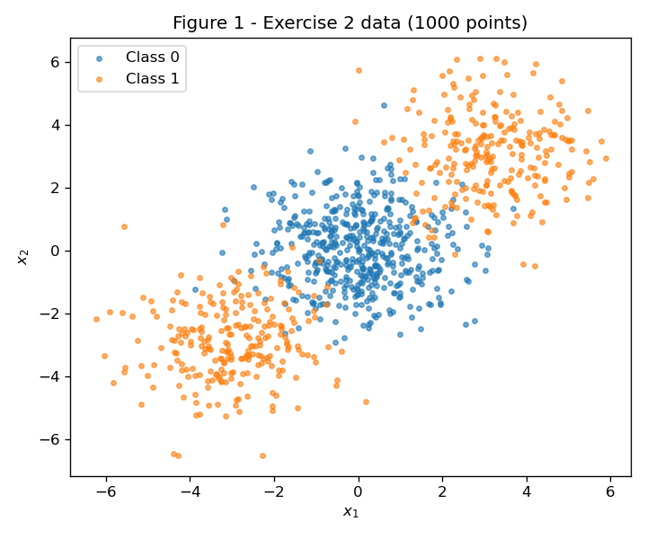
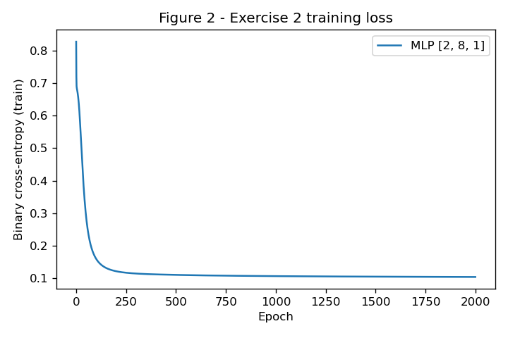
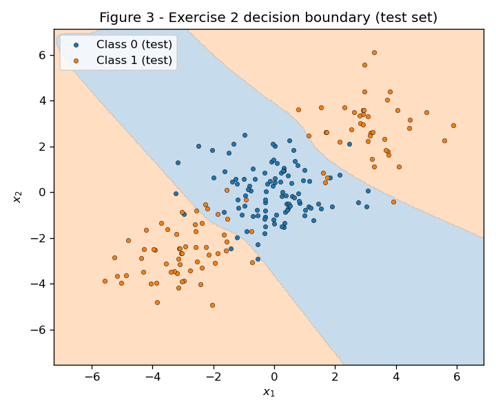
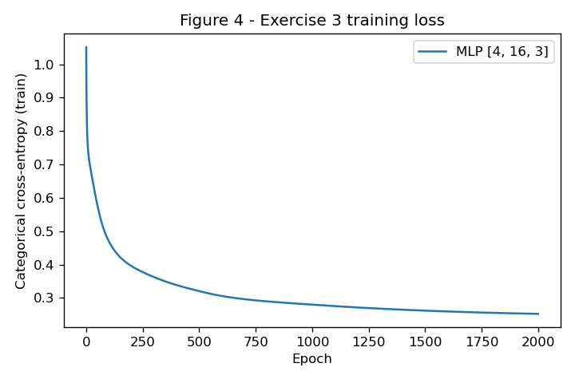
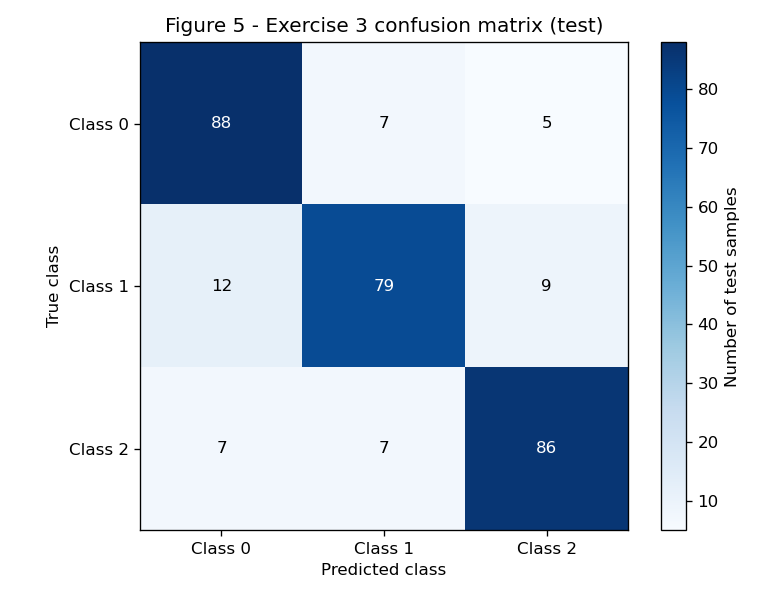
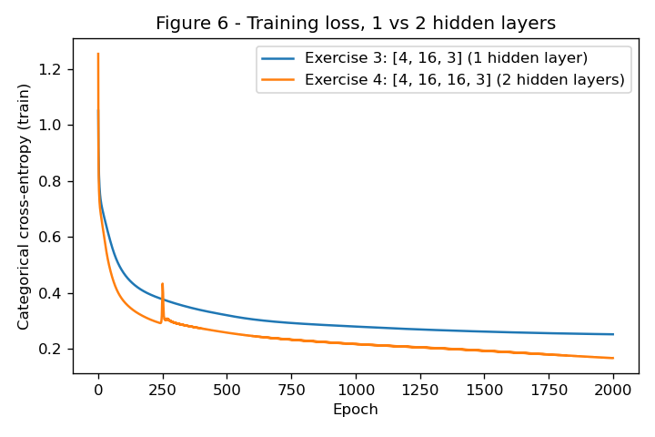

# 3. MLP

Todo o código está em `code/`:

- `mlp.py`: a classe `MLP` escrita do zero com numpy (inicialização, forward, loss, backward, atualização). É a **mesma** classe, sem nenhuma alteração, nos Exercícios 2, 3 e 4.
- `experiments.py`: dados, treinamento, figuras e números dos Exercícios 2, 3 e 4.
- `check_ex1.py`: apenas confere numericamente as contas feitas à mão no Exercício 1.

Para reproduzir, a partir da raiz do repositório:

```
python docs/exercises/mlp/code/check_ex1.py
python docs/exercises/mlp/code/experiments.py
```

Um único gerador `rng = np.random.default_rng(42)` é criado no topo de `experiments.py` e compartilhado por todos os modelos, na ordem em que aparecem. Os únicos geradores adicionais são os da comparação com várias seeds do Exercício 4, que o próprio enunciado pede.

```python
--8<-- "docs/exercises/mlp/code/mlp.py"
```

---

## Exercise 1

### One Step of Backpropagation, by Hand

Rede 2 → 2 → 1, \(\tanh\) nas duas camadas, loss \(L = (y - \hat{y})^2\) com \(N = 1\). Valores dados: \(\mathbf{x} = [0.5, -0.2]\), \(y = 1.0\), \(\mathbf{W}^{(1)} = \begin{bmatrix} 0.3 & -0.1 \\ 0.2 & 0.4 \end{bmatrix}\), \(\mathbf{b}^{(1)} = [0.1, -0.2]\), \(\mathbf{W}^{(2)} = [0.5, -0.3]\), \(b^{(2)} = 0.2\), \(\eta = 0.3\).

As contas abaixo foram feitas à mão. O script `check_ex1.py` refaz as mesmas operações em numpy só para conferir; todos os valores batem até a 6ª casa.

### A — Forward pass

**1. Pré-ativações ocultas.** Cada neurônio oculto faz uma soma ponderada das entradas mais o seu viés:

$$
z^{(1)}_1 = 0.3 \cdot 0.5 + (-0.1)(-0.2) + 0.1 = 0.15 + 0.02 + 0.1 = 0.2700
$$

$$
z^{(1)}_2 = 0.2 \cdot 0.5 + 0.4 \cdot (-0.2) - 0.2 = 0.10 - 0.08 - 0.20 = -0.1800
$$

$$
\mathbf{z}^{(1)} = [0.2700,\; -0.1800]
$$

**2. Ativações ocultas.**

$$
\mathbf{h}^{(1)} = \tanh(\mathbf{z}^{(1)}) = [\tanh(0.27),\; \tanh(-0.18)] = [0.2636,\; -0.1781]
$$

(com mais casas: \(0.263625\) e \(-0.178081\), que uso nas contas seguintes para não acumular arredondamento).

**3. Pré-ativação de saída.**

$$
u^{(2)} = 0.5 \cdot 0.263625 + (-0.3)(-0.178081) + 0.2 = 0.131812 + 0.053424 + 0.2 = 0.3852
$$

**4. Saída e loss.**

$$
\hat{y} = \tanh(0.385237) = 0.3672
$$

$$
L = (1 - 0.367247)^2 = 0.632753^2 = 0.4004
$$

### B — Backward pass

A ideia é a regra da cadeia: a loss depende de \(\hat{y}\), que depende de \(u^{(2)}\), que depende de \(\mathbf{W}^{(2)}\), \(b^{(2)}\) e \(\mathbf{h}^{(1)}\), e assim por diante para trás. Em cada passo multiplico "o quanto a loss muda com a saída deste bloco" por "o quanto a saída deste bloco muda com a sua entrada".

**Ponto de partida.**

$$
\frac{\partial L}{\partial \hat{y}} = -2(y - \hat{y}) = -2(0.632753) = -1.2655
$$

**1. Através do tanh de saída.** Como \(\frac{d}{du}\tanh(u) = 1 - \tanh^2(u)\) e \(\tanh(u^{(2)}) = \hat{y}\):

$$
1 - \hat{y}^2 = 1 - 0.367247^2 = 1 - 0.134870 = 0.865130
$$

$$
\frac{\partial L}{\partial u^{(2)}} = \frac{\partial L}{\partial \hat{y}} \cdot (1 - \hat{y}^2) = -1.265507 \cdot 0.865130 = -1.0948
$$

Chamo esse valor de \(\delta^{(2)} = -1.094828\): é o "erro" do neurônio de saída.

**2. Camada de saída.** Como \(u^{(2)} = W^{(2)}_1 h_1 + W^{(2)}_2 h_2 + b^{(2)}\), a derivada de \(u^{(2)}\) em relação a cada peso é a entrada que ele multiplica, e em relação ao viés é 1:

$$
\frac{\partial L}{\partial \mathbf{W}^{(2)}} = \delta^{(2)} \, \mathbf{h}^{(1)} = -1.094828 \cdot [0.263625,\; -0.178081] = [-0.2886,\; 0.1950]
$$

$$
\frac{\partial L}{\partial b^{(2)}} = \delta^{(2)} = -1.0948
$$

**3. Propagando para trás.** \(u^{(2)}\) depende de \(h_i\) através do peso \(W^{(2)}_i\), então:

$$
\frac{\partial L}{\partial \mathbf{h}^{(1)}} = \delta^{(2)} \, \mathbf{W}^{(2)} = -1.094828 \cdot [0.5,\; -0.3] = [-0.5474,\; 0.3284]
$$

E através do tanh oculto, com \(1 - h_1^2 = 1 - 0.069498 = 0.930502\) e \(1 - h_2^2 = 1 - 0.031713 = 0.968287\):

$$
\frac{\partial L}{\partial \mathbf{z}^{(1)}} = \frac{\partial L}{\partial \mathbf{h}^{(1)}} \odot (1 - \mathbf{h}^{(1)} \odot \mathbf{h}^{(1)}) = [-0.547414 \cdot 0.930502,\; 0.328448 \cdot 0.968287] = [-0.5094,\; 0.3180]
$$

Chamo esse vetor de \(\boldsymbol{\delta}^{(1)} = [-0.509370,\; 0.318032]\).

**4. Camada oculta.** Como \(z^{(1)}_i = \sum_j W^{(1)}_{ij} x_j + b^{(1)}_i\), o gradiente do peso que liga a entrada \(j\) ao neurônio \(i\) é \(\delta^{(1)}_i \, x_j\) (produto externo):

$$
\frac{\partial L}{\partial \mathbf{W}^{(1)}} = \boldsymbol{\delta}^{(1)} \mathbf{x}^\top =
\begin{bmatrix} -0.509370 \cdot 0.5 & -0.509370 \cdot (-0.2) \\ 0.318032 \cdot 0.5 & 0.318032 \cdot (-0.2) \end{bmatrix} =
\begin{bmatrix} -0.2547 & 0.1019 \\ 0.1590 & -0.0636 \end{bmatrix}
$$

$$
\frac{\partial L}{\partial \mathbf{b}^{(1)}} = \boldsymbol{\delta}^{(1)} = [-0.5094,\; 0.3180]
$$

### C — Parameter update

Cada parâmetro anda um passo \(\eta = 0.3\) na direção contrária ao seu gradiente, \(\theta \leftarrow \theta - \eta \, \partial L / \partial \theta\):

| Parâmetro | Antes | Gradiente | Depois |
| --- | --- | --- | --- |
| \(W^{(2)}_1\) | 0.5 | −0.288624 | 0.5 + 0.086587 = **0.5866** |
| \(W^{(2)}_2\) | −0.3 | 0.194968 | −0.3 − 0.058490 = **−0.3585** |
| \(b^{(2)}\) | 0.2 | −1.094828 | 0.2 + 0.328448 = **0.5284** |
| \(W^{(1)}_{11}\) | 0.3 | −0.254685 | 0.3 + 0.076405 = **0.3764** |
| \(W^{(1)}_{12}\) | −0.1 | 0.101874 | −0.1 − 0.030562 = **−0.1306** |
| \(W^{(1)}_{21}\) | 0.2 | 0.159016 | 0.2 − 0.047705 = **0.1523** |
| \(W^{(1)}_{22}\) | 0.4 | −0.063606 | 0.4 + 0.019082 = **0.4191** |
| \(b^{(1)}_1\) | 0.1 | −0.509370 | 0.1 + 0.152811 = **0.2528** |
| \(b^{(1)}_2\) | −0.2 | 0.318032 | −0.2 − 0.095410 = **−0.2954** |

(Os oito "parâmetros" do enunciado são os grupos \(\mathbf{W}^{(2)}\), \(b^{(2)}\), \(\mathbf{W}^{(1)}\), \(\mathbf{b}^{(1)}\) contando os pesos de \(\mathbf{W}^{(2)}\) e de \(\mathbf{b}^{(1)}\) como pares; na tabela estão todos os nove números escalares.)

**A loss desce no segundo forward.** O gradiente aponta para onde a loss mais cresce; andar um passo pequeno na direção oposta a reduz, já que, em primeira ordem, \(L(\theta - \eta \mathbf{g}) \approx L(\theta) - \eta \, \mathbf{g}^\top \mathbf{g} < L(\theta)\). Intuitivamente: \(\hat{y} = 0.3672\) estava abaixo do alvo \(1.0\), então todas as mudanças empurram \(u^{(2)}\) para cima (o viés de saída sobe, o peso ligado ao \(h_1\) positivo sobe, o peso ligado ao \(h_2\) negativo fica mais negativo). Conferi com `check_ex1.py`: no segundo forward, \(u^{(2)} = 0.8896\), \(\hat{y} = 0.7112\) e \(L = 0.0834\), contra \(0.4004\) antes. O passo \(\eta = 0.3\) foi pequeno o bastante para a aproximação de primeira ordem valer.

```python
--8<-- "docs/exercises/mlp/code/check_ex1.py"
```

---

## Exercise 2

### Binary Classification a Straight Line Cannot Do

### A — Generate the data

Dados gerados exatamente com os parâmetros do enunciado (`make_blobs` com centros \((0,0)\), \((3,3)\), \((-3,-3)\), 500/250/250 pontos, `cluster_std=1.2`, `random_state=42`) e divididos 80/20 com `train_test_split(..., test_size=0.2, random_state=42, stratify=y)`: 800 pontos de treino (400 de cada classe) e 200 de teste.



**Figure 1**: a classe 0 é um único cluster no centro; a classe 1 são dois clusters em cantos opostos, um de cada lado da classe 0.

### B — Establish the baseline

Uma regressão logística (`sklearn.linear_model.LogisticRegression`, usada só como baseline) treinada no conjunto de treino atinge **47.50%** de acurácia no teste, abaixo de um palpite aleatório.

### C — Implement the MLP

A classe `MLP` (em `mlp.py`, mostrada no topo) recebe a lista de tamanhos das camadas como argumento. Os pontos principais:

- **Forward:** para cada camada, \(\mathbf{Z} = \mathbf{A}\mathbf{W} + \mathbf{b}\) e depois a ativação: \(\tanh\) nas camadas ocultas, sigmoide na saída (binário). Cada ativação fica guardada em cache para o backward.
- **Loss:** entropia cruzada binária média, \(L = -\frac{1}{N}\sum [y \log p + (1-y)\log(1-p)]\).
- **Backward:** para sigmoide + entropia cruzada binária, o gradiente na pré-ativação de saída é simplesmente \(\partial L / \partial u = (p - y)/N\) (a derivada da sigmoide, \(p(1-p)\), cancela o denominador da derivada do log). A partir daí, em cada camada: \(\partial L/\partial \mathbf{W} = \mathbf{A}_{\text{anterior}}^\top \boldsymbol{\delta}\), \(\partial L/\partial \mathbf{b} = \sum \boldsymbol{\delta}\), e para descer uma camada \(\boldsymbol{\delta} \leftarrow (\boldsymbol{\delta}\mathbf{W}^\top) \odot (1 - \mathbf{h}^2)\). É a mesma regra da cadeia do Exercício 1, em forma matricial para \(N\) amostras e qualquer profundidade.
- **Atualização:** gradiente descendente com o lote inteiro, \(\theta \leftarrow \theta - \eta \, \partial L/\partial\theta\).
- **Inicialização:** Xavier, pesos \(\sim \mathcal{N}(0, 2/(n_\text{in} + n_\text{out}))\) usando o `rng` compartilhado, vieses zero. Mantém o \(\tanh\) fora da região saturada no início do treino.

Antes de usar a classe, comparei os gradientes do `backward` com diferenças finitas numa rede pequena de duas camadas ocultas: o erro máximo foi da ordem de \(10^{-10}\), para os dois tipos de saída.

**1. Configuração e resultado.**

- Arquitetura: **2 → 8 → 1** (uma camada oculta de 8 neurônios \(\tanh\), saída sigmoide), 33 parâmetros
- Taxa de aprendizado: **0.5**
- Épocas: **2000** (gradiente descendente com o lote inteiro)
- Loss de treino: **0.8270** na primeira época, **0.1046** na última
- Acurácia de teste: **91.50%**



**Figure 2**: loss de treino por época. Cai rápido nas primeiras dezenas de épocas e depois converge suavemente.



**Figure 3**: fronteira de decisão da rede sobre os pontos de teste (fundo azul: região prevista como classe 0; fundo laranja: classe 1).

O código dos Exercícios 2, 3 e 4:

```python
--8<-- "docs/exercises/mlp/code/experiments.py"
```

### D — Analysis

**A forma da região da classe 1 (Figure 3).** A rede atribui à classe 0 uma **faixa diagonal** que atravessa o plano do canto superior esquerdo ao inferior direito, passando pela origem. A região da classe 1 são **duas peças desconectadas**, uma acima e à direita da faixa (cobrindo o cluster em \((3,3)\)) e outra abaixo e à esquerda (cobrindo o cluster em \((-3,-3)\)). Na prática a rede aprendeu duas fronteiras quase paralelas: cada neurônio oculto \(\tanh\) é ele próprio uma reta suavizada, e a saída combina essas retas para formar a faixa.

**Por que nenhuma reta produz isso.** Uma reta divide o plano em exatamente dois semiplanos, e cada semiplano é uma região única e convexa. A classe 1 precisa de uma região que contenha \((3,3)\) e \((-3,-3)\) mas não o ponto médio entre eles, \((0,0)\), que é da classe 0. Isso é impossível para um semiplano: se dois pontos estão nele, o segmento inteiro entre eles também está.

**Por que o baseline fica abaixo de 50%, e não só "não muito bom".** Não é que nenhuma reta acerte mais da metade: a regra \(x_1 + x_2 > 3\), que isola só o cluster de cima, acertaria 71.9% dos dados. O problema é o critério da regressão logística. Ela não maximiza acurácia, minimiza a log-loss, e os dados são simétricos em torno da origem: para qualquer reta que favoreça um dos clusters da classe 1, o cluster espelhado puxa o gradiente com a mesma força no sentido oposto. O ótimo da log-loss fica praticamente em "não decidir nada": os coeficientes ajustados são \(w \approx [0.030,\; 0.001]\) e \(b \approx -0.003\), e as probabilidades previstas no teste ficam todas entre 0.457 e 0.544. A fronteira resultante é uma reta quase arbitrária que corta o cluster da classe 0 ao meio e deixa um cluster da classe 1 de cada lado, então cada lado erra cerca de metade dos pontos, e o ruído deixa a acurácia em 47.50%. A MLP, com 91.50%, resolve exatamente o que falta: a camada oculta permite uma região de decisão que não é um semiplano.

---

## Exercise 3

### Multi-Class, Same Network

### A — Generate the data

`make_classification` com exatamente os parâmetros do enunciado (1500 amostras, 4 features informativas, 3 classes, 2 clusters por classe, `class_sep=1.0`, `random_state=42`), dividido 80/20 com `random_state=42` e `stratify=y`: 1200 pontos de treino e 300 de teste (100 por classe).

### B — Adapt the network

A **mesma** classe `MLP` do Exercício 2 é usada sem nenhuma alteração. Só mudam os argumentos: `layer_sizes=[4, 16, 3]` e `output="softmax"`. Com `output="softmax"`:

- a camada de saída tem 3 unidades;
- a **softmax** transforma as pré-ativações em probabilidades: \(p_k = e^{u_k} / \sum_j e^{u_j}\);
- a **entropia cruzada categórica**, \(L = -\sum_k y_k \log p_k\) (com \(\mathbf{y}\) one-hot), substitui a binária.

Forward, backward e atualização são literalmente o mesmo código do Exercício 2. Isso funciona por causa da derivação abaixo.

**Derivação de \(\partial L / \partial u\) para softmax + entropia cruzada** (uma amostra).

Primeiro, a derivada da softmax. Para \(k = j\), pela regra do quociente:

$$
\frac{\partial p_k}{\partial u_k} = \frac{e^{u_k} \sum_i e^{u_i} - e^{u_k} e^{u_k}}{\left(\sum_i e^{u_i}\right)^2} = p_k - p_k^2 = p_k(1 - p_k)
$$

Para \(k \neq j\), o numerador de \(p_k\) não depende de \(u_j\):

$$
\frac{\partial p_k}{\partial u_j} = \frac{- e^{u_k} e^{u_j}}{\left(\sum_i e^{u_i}\right)^2} = -p_k p_j
$$

Os dois casos juntos: \(\dfrac{\partial p_k}{\partial u_j} = p_k(\delta_{kj} - p_j)\), com \(\delta_{kj} = 1\) se \(k = j\) e 0 caso contrário.

Agora a loss. Como \(\partial(\log p_k)/\partial p_k = 1/p_k\):

$$
\frac{\partial L}{\partial u_j} = -\sum_k y_k \frac{1}{p_k} \frac{\partial p_k}{\partial u_j} = -\sum_k y_k \frac{1}{p_k} p_k(\delta_{kj} - p_j) = -\sum_k y_k \delta_{kj} + p_j \sum_k y_k
$$

O primeiro somatório só sobrevive em \(k = j\) e vale \(y_j\). No segundo, \(\sum_k y_k = 1\) porque \(\mathbf{y}\) é one-hot. Logo:

$$
\boxed{\frac{\partial L}{\partial u_j} = p_j - y_j} \qquad \text{ou seja,} \qquad \frac{\partial L}{\partial \mathbf{u}} = \mathbf{p} - \mathbf{y}
$$

e, para a média sobre \(N\) amostras, \((\mathbf{P} - \mathbf{Y})/N\).

**Por que isso é importante.** O \(1/p_k\) que vem do log cancela exatamente o \(p_k\) que vem da derivada da softmax, então o gradiente é só "previsão menos alvo". É o **mesmo** formato do caso sigmoide + entropia cruzada binária do Exercício 2 (a sigmoide é a softmax de duas classes). Por isso o método `backward` da classe começa com `delta = (P - Y) / N` e não precisa saber qual saída está em uso: o reaproveitamento do código sem alterações não é um truque, é consequência dessa conta. Além disso, o gradiente nunca "morre" quando a previsão está muito errada (se \(p_j \approx 0\) e \(y_j = 1\), o gradiente é \(\approx -1\)), ao contrário do que aconteceria com MSE sobre a softmax.

### C — Train and evaluate

**1. Configuração e resultado.**

- Arquitetura: **4 → 16 → 3** (uma camada oculta de 16 neurônios \(\tanh\), saída softmax), 131 parâmetros
- Taxa de aprendizado: **0.5**; épocas: **2000** (gradiente descendente com o lote inteiro); inicialização Xavier com o `rng` compartilhado
- Loss de treino: **1.0511** na primeira época, **0.2525** na última
- Acurácia de teste: **84.33%**



**Figure 4**: loss de treino por época.



**Figure 5**: matriz de confusão no teste (linhas: classe verdadeira; colunas: classe prevista).

| Verdadeira \ Prevista | Classe 0 | Classe 1 | Classe 2 |
| --- | --- | --- | --- |
| Classe 0 | 88 | 7 | 5 |
| Classe 1 | 12 | 79 | 9 |
| Classe 2 | 7 | 7 | 86 |

### D — Analysis

**Par mais confundido.** Segundo a Figure 5, o par mais confundido é **classe 0 e classe 1**: 12 pontos da classe 1 foram previstos como 0 e 7 da classe 0 como 1, **19 erros** no total. Os outros pares somam 16 (classes 1 e 2: 9 + 7) e 12 (classes 0 e 2: 5 + 7). A classe 1 é a pior individualmente: recall de 79/100, contra 88 e 86 das outras.

**Explicação pela estrutura dos dados.** O `make_classification` coloca os centros dos clusters em vértices de um hipercubo em 4 dimensões, com aresta \(2 \times\) `class_sep` \(= 2\), e espalha cada cluster como uma gaussiana de desvio 1 em cada eixo. São 6 clusters (2 por classe) em vértices a distância 2 dos vizinhos mais próximos, ou seja, só 2 desvios-padrão. Os clusters vizinhos se sobrepõem bastante, e nessas zonas de sobreposição não há fronteira que acerte tudo: o erro é inerente aos dados, não falta de capacidade da rede.

Para quantificar isso sem modelo nenhum, contei, para cada ponto, a classe dos seus 10 vizinhos mais próximos no espaço original de 4 dimensões. Os pontos da classe 1 são os mais "cercados" por outras classes: só 77.5% dos seus vizinhos são da classe 1 (10.8% da classe 0 e 11.7% da classe 2), contra 81.3% para a classe 0 e 79.0% para a classe 2. Isso é consistente com algum cluster da classe 1 ficar entre clusters das outras duas classes no hipercubo, e explica por que a classe 1 concentra os erros. A diferença entre os pares 0–1 (19 erros) e 1–2 (16 erros) é pequena para 300 pontos de teste, então a conclusão mais firme é "a classe 1 é a que mais se sobrepõe", sendo o par 0–1 o mais afetado neste split.

**O que a camada oculta acrescentou.** A regressão logística multinomial (linear) atinge **66.33%** no teste; a MLP atinge **84.33%**, um ganho de **18 pontos percentuais**. Com 2 clusters por classe, a região de cada classe é a união de duas "bolhas" separadas no espaço 4D. Um modelo linear dá a cada classe uma única região convexa (a interseção de semiplanos), então não consegue cobrir dois clusters distantes da mesma classe sem engolir um cluster de outra classe no meio do caminho; é o mesmo problema do Exercício 2, agora em 4 dimensões e com 3 classes. A camada oculta permite regiões não convexas e desconectadas, e por isso recupera quase toda a acurácia que é possível dada a sobreposição.

---

## Exercise 4

### Does a Second Hidden Layer Help?

Mesmos dados e mesmo split do Exercício 3, mesmo número de épocas (2000), mesma taxa de aprendizado (0.5), mesma inicialização Xavier e a mesma classe `MLP`, sem alterações. A única mudança é a profundidade.

### A — Train the deeper network

- Arquitetura: **4 → 16 → 16 → 3** (duas camadas ocultas de 16 neurônios \(\tanh\), saída softmax), 403 parâmetros
- Taxa de aprendizado: **0.5**; épocas: **2000**
- Treinada com o `rng` compartilhado (logo depois do modelo do Exercício 3): loss de treino final **0.1677**, acurácia de teste **84.67%**

### B — Compare



**Figure 6**: curvas de loss de treino da rede do Exercício 3 (1 camada oculta) e do Exercício 4 (2 camadas ocultas), nos mesmos eixos.

Para comparar modelos e não sorte de inicialização, treinei as duas arquiteturas com três seeds diferentes (42, 43 e 44), cada modelo com o seu próprio `np.random.default_rng(seed)`. Os dados e o split são fixos; só a inicialização dos pesos muda entre seeds.

| Seed | Ex. 3: loss final | Ex. 3: acurácia | Ex. 4: loss final | Ex. 4: acurácia |
| --- | --- | --- | --- | --- |
| 42 | 0.2610 | 85.33% | 0.1658 | 82.33% |
| 43 | 0.2551 | 84.00% | 0.1646 | 84.33% |
| 44 | 0.2532 | 83.33% | 0.1719 | 84.33% |

Tabela pedida no enunciado (média ± desvio-padrão sobre as 3 seeds):

|            | hidden layers | parameters | final train loss | test accuracy |
| ---------- | ------------- | ---------- | ---------------- | ------------- |
| Exercise 3 | 1             | 131        | 0.2565 ± 0.0033  | 84.22% ± 0.83 |
| Exercise 4 | 2             | 403        | 0.1674 ± 0.0032  | 83.67% ± 0.94 |

Diferença de acurácia (Ex. 4 − Ex. 3), média sobre as seeds: **−0.56 pontos percentuais**.

### C — Analysis

**O resultado.** A rede mais profunda tem 3 vezes mais parâmetros (403 contra 131) e chega a uma loss de treino bem menor (0.1674 contra 0.2565, em média), mas a acurácia de teste **não melhora**: fica 0.56 ponto percentual abaixo em média, uma diferença menor que o desvio-padrão entre seeds (≈ 0.9 p.p.). Ou seja, a profundidade extra não comprou nada no teste. Vale notar que, na rodada única com o `rng` compartilhado, a rede profunda saiu ligeiramente na frente (84.67% contra 84.33%); com três seeds, a ordem se inverte. Uma única rodada teria levado à conclusão errada, e é exatamente por isso que o enunciado pede a média.

**Quanta complexidade os dados pedem.** Os dados têm 6 clusters gaussianos em vértices de um hipercubo 4D. A fronteira ideal entre eles é relativamente simples: algumas superfícies separando bolhas vizinhas. Uma camada oculta com 16 neurônios já consegue desenhar essas regiões, como mostram os 84% contra 66% do modelo linear. O que sobra de erro vem da **sobreposição** dos clusters (vizinhos a só 2 desvios-padrão, como visto no Exercício 3), e nenhuma arquitetura corrige pontos que estão do lado "errado" de uma gaussiana: ali o erro é ruído irreduzível, não falta de capacidade.

**O que a segunda camada acrescenta e o que custa.** Em termos de representação, a segunda camada permite compor funções: a primeira camada desenha "retas" (hiperplanos) e a segunda combina essas regiões em formas mais elaboradas, com muito menos neurônios do que uma única camada larga precisaria para a mesma forma. Mas aqui essa capacidade extra não tem estrutura útil para capturar, então é gasta **decorando** os pontos de treino nas zonas de sobreposição. É por isso que a loss de treino e a acurácia de teste contam histórias diferentes: a loss de treino cai muito mais para a rede profunda (Figure 6), mas essa queda é ajuste a ruído e não se converte em acerto no teste. É um começo de overfitting. Do lado da otimização, a rede profunda é mais difícil de treinar: o gradiente passa por duas derivadas de \(\tanh\) em sequência e a superfície de loss é menos regular. A Figure 6 mostra isso: com o mesmo \(\eta = 0.5\), a curva da rede profunda tem um **pico de instabilidade** perto da época 250, em que a loss sobe abruptamente antes de voltar a cair, coisa que a rede rasa não tem. Isso também explica por que as seeds 43 e 44 deram resultados ligeiramente diferentes entre a minha máquina e a do assistente (diferenças de arredondamento de ponto flutuante amplificadas por esse trecho instável), enquanto a rede rasa reproduziu identicamente.

**Que dados recompensariam a profundidade.** Dados com estrutura **hierárquica ou composicional**, em que padrões complexos são combinações de padrões mais simples: imagens (bordas → texturas → partes → objetos), fala, texto. Também fronteiras de decisão muito intrincadas, como espirais entrelaçadas ou tabuleiros de xadrez com muitas casas, onde uma camada só precisaria de um número enorme de neurônios para o que duas camadas fazem com poucos. E, em qualquer caso, **muito mais dados** em relação ao número de parâmetros e pouca sobreposição entre classes, para que a capacidade extra seja usada em estrutura real e não em ruído. Nada disso descreve 1500 pontos de 6 gaussianas sobrepostas em 4 dimensões.

---

## Results summary

| # | Quantity | Value |
| --- | --- | --- |
| 1 | Ex. 1 — \(\mathbf{z}^{(1)}\) and \(\mathbf{h}^{(1)}\) | \(\mathbf{z}^{(1)} = [0.2700, -0.1800]\); \(\mathbf{h}^{(1)} = [0.2636, -0.1781]\) |
| 2 | Ex. 1 — \(u^{(2)}\), \(\hat{y}\) and \(L\) | \(u^{(2)} = 0.3852\); \(\hat{y} = 0.3672\); \(L = 0.4004\) |
| 3 | Ex. 1 — the eight updated parameters | \(\mathbf{W}^{(2)} = [0.5866, -0.3585]\); \(b^{(2)} = 0.5284\); \(\mathbf{W}^{(1)} = \begin{bmatrix} 0.3764 & -0.1306 \\ 0.1523 & 0.4191 \end{bmatrix}\); \(\mathbf{b}^{(1)} = [0.2528, -0.2954]\) (loss no 2º forward: 0.0834) |
| 4 | Ex. 2 — linear baseline test accuracy | 47.50% |
| 5 | Ex. 2 — architecture and test accuracy | 2 → 8 → 1 (tanh, sigmoide), η = 0.5, 2000 épocas: 91.50% |
| 6 | Ex. 3 — architecture and test accuracy | 4 → 16 → 3 (tanh, softmax), η = 0.5, 2000 épocas: 84.33% |
| 7 | Ex. 3 — most-confused class pair | Classes 0 e 1 (12 + 7 = 19 erros no teste) |
| 8 | Ex. 4 — architecture and test accuracy | 4 → 16 → 16 → 3 (tanh, softmax), η = 0.5, 2000 épocas: 84.67% (rng compartilhado); 83.67% em média sobre 3 seeds |
| 9 | Ex. 4 — accuracy difference against Ex. 3 (mean over ≥ 3 seeds) | −0.56 p.p. (83.67% contra 84.22%, seeds 42, 43, 44) |
