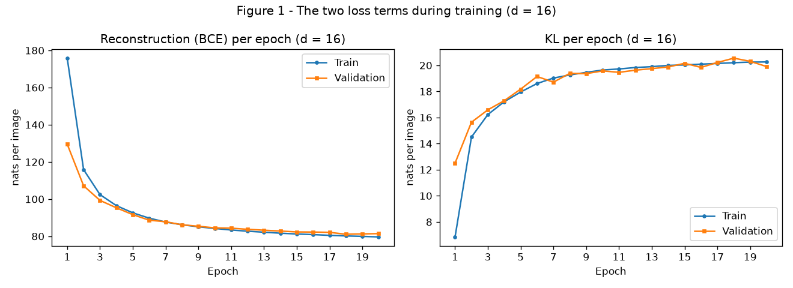
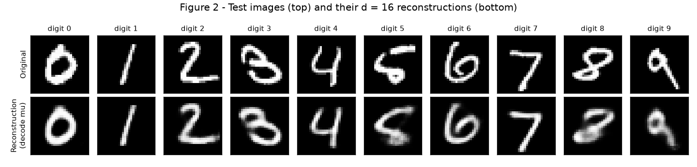
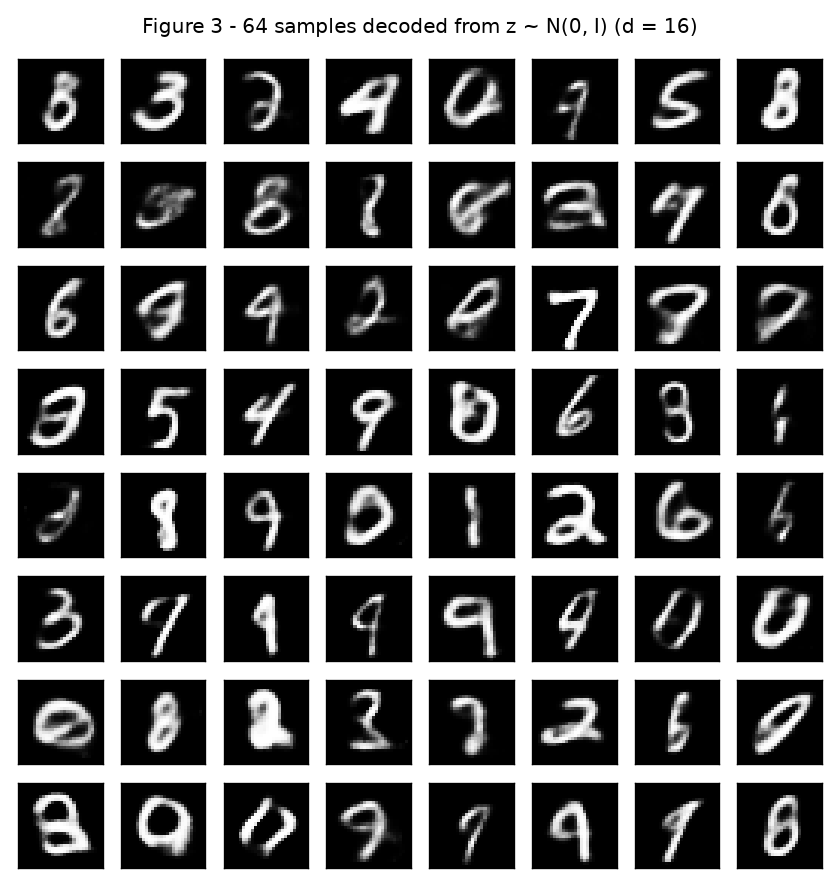
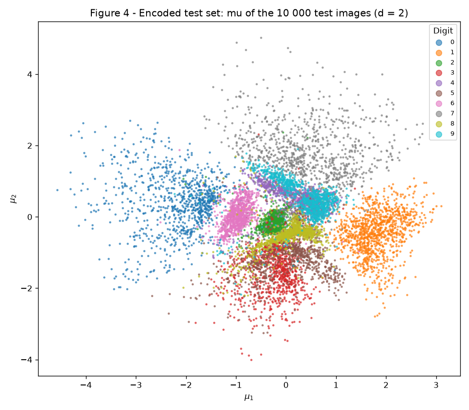
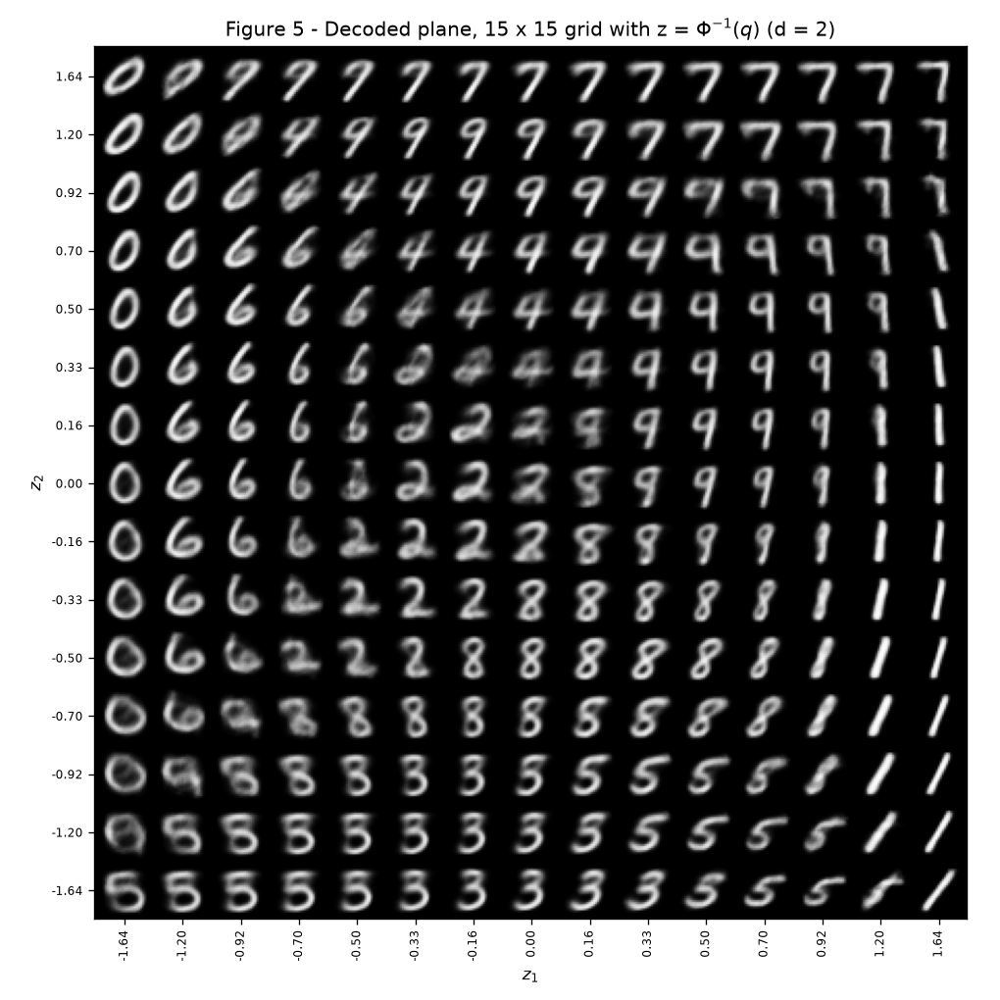
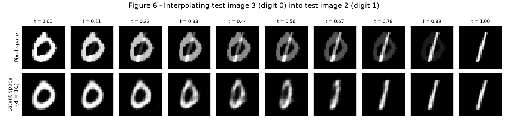

# 4. VAE

Todo o código está em `code/`:

- `vae.py`: o modelo e as partes específicas do VAE escritas à mão (reparametrização, os dois termos da loss e a amostragem do prior), além do laço de uma época.
- `experiments.py`: dados, treinamento dos dois modelos (\(d = 16\) e \(d = 2\)), figuras e todos os números deste relatório.

Para reproduzir, a partir da raiz do repositório (o MNIST é baixado para `data/`, que está no `.gitignore`):

```
pip install -r requirements.txt
python docs/exercises/vae/code/experiments.py
```

O `requirements.txt` aponta para a versão de CPU do PyTorch. Em CPU, cada modelo leva alguns minutos. No Anaconda, rode num ambiente separado (`conda create -n anndl python=3.11`, depois `pip install numpy matplotlib scipy torch torchvision --extra-index-url https://download.pytorch.org/whl/cpu`): instalar o PyTorch do pip no ambiente base gera um conflito de OpenMP (`libiomp5md.dll` duplicada) que interrompe o script.

Sementes: `torch.manual_seed(42)` imediatamente antes de construir cada modelo, o gerador do enunciado no split (`torch.Generator().manual_seed(42)`) e `torch.manual_seed(0)` antes das amostras da Figure 3. O autograd do PyTorch calcula os gradientes e o Adam faz a atualização, o que o enunciado permite. O que é próprio do VAE está escrito à mão: não uso nenhuma classe de VAE de biblioteca, nem `torch.distributions.kl_divergence`.

```python
--8<-- "docs/exercises/vae/code/vae.py"
```

```python
--8<-- "docs/exercises/vae/code/experiments.py"
```

---

## Exercise 1

### A VAE on MNIST

### A — Load and split the data

O MNIST vem do `torchvision` com `transforms.ToTensor()`, ou seja, pixels em \([0, 1]\), e cada imagem é achatada num vetor de 784 posições. As 60 000 imagens de treino são divididas exatamente com o código do enunciado:

```python
train, val = random_split(train_full, [50_000, 10_000],
                          generator=torch.Generator().manual_seed(42))
```

Resultado: **50 000 imagens de treino**, **10 000 de validação** e as **10 000 imagens oficiais de teste** como conjunto de teste. Para acelerar, os pixels são lidos direto dos tensores do dataset e divididos por 255, o que é exatamente a operação do `ToTensor()`; os índices do treino e da validação são os do `random_split`.

O conjunto de teste não participa de nenhuma decisão: durante o treino só olho a validação, e o teste é avaliado uma única vez por modelo, no final, para os números reportados.

### B — Build the model

A arquitetura é a do enunciado:

| Parte | Camadas |
| --- | --- |
| Encoder | 784 → 512 → 256, ReLU depois de cada uma |
| Cabeças | duas lineares 256 → \(d\): uma para \(\mathbf{\mu}\), outra para \(\log \mathbf{\sigma}^2\) |
| Decoder | \(d\) → 256 → 512 → 784, ReLU nas ocultas, **sigmoide** na saída |

com \(d = 16\) e \(\beta = 1\).

**Reparametrização.** O encoder não devolve um código, devolve uma distribuição \(q(z \mid x) = \mathcal{N}(\mathbf{\mu}, \operatorname{diag}(\mathbf{\sigma}^2))\). Para treinar, preciso amostrar \(z\) dessa distribuição, e um sorteio no meio da rede impediria o gradiente de passar. A saída é escrever a amostra como

$$
z = \mathbf{\mu} + \mathbf{\sigma} \odot \mathbf{\varepsilon}, \qquad \mathbf{\varepsilon} \sim \mathcal{N}(0, I), \qquad \mathbf{\sigma} = \exp\!\left(\tfrac{1}{2}\log \mathbf{\sigma}^2\right)
$$

O acaso fica todo em \(\mathbf{\varepsilon}\), que não depende de nenhum parâmetro; \(z\) vira uma conta comum de \(\mathbf{\mu}\) e \(\mathbf{\sigma}\), e o gradiente passa por ela normalmente. A cabeça prevê \(\log \mathbf{\sigma}^2\) (e não \(\mathbf{\sigma}\)) porque assim a saída pode ser qualquer número real e \(\mathbf{\sigma}\) sai sempre positivo.

**Os dois termos da loss**, por imagem:

$$
L = \underbrace{-\sum_{j=1}^{784} \Big[x_j \log \hat{x}_j + (1 - x_j) \log (1 - \hat{x}_j)\Big]}_{\text{reconstrução (BCE)}} \;+\; \beta \cdot \underbrace{\tfrac{1}{2}\sum_{i=1}^{d} \left(\mu_i^2 + \sigma_i^2 - 1 - \log \sigma_i^2\right)}_{\text{KL}}
$$

- **Reconstrução:** `F.binary_cross_entropy(x_hat, x, reduction="sum")` dividido pelo tamanho do lote, ou seja, soma nos 784 pixels e média nas imagens. Usar `reduction="mean"` dividiria também pelos 784 pixels e equivaleria a usar \(\beta \approx 784\).
- **KL:** escrito em forma fechada em `kl_divergence`, somado nas \(d\) dimensões latentes e com média nas imagens. Ele mede o quanto a distribuição do encoder se afasta do prior \(\mathcal{N}(0, I)\): vale zero só quando \(\mu_i = 0\) e \(\sigma_i = 1\) em todas as dimensões.

A soma dos dois é o ELBO negativo. Os dois termos estão em **nats por imagem** e são sempre registrados separados.

### C — Train

Adam com taxa de aprendizado \(10^{-3}\), lote de 128 imagens, **20 épocas**. Ao fim de cada época registro a reconstrução e o KL médios da época no treino, e os mesmos termos na validação.

**1. Números de teste (\(d = 16\)):**

- Reconstrução: **80.80 nats por imagem**
- KL: **19.96 nats por imagem**
- ELBO negativo (soma): **100.77 nats por imagem**

São praticamente os valores de referência do enunciado (cerca de 81 e 20).

Evolução da validação: o KL foi de **12.50** na primeira época para **19.91** na última (máximo de 20.55 na época 18); a reconstrução foi de 129.59 para 81.45. No treino, a média da primeira época dá 6.85 de KL e 175.85 de reconstrução, e a última dá 20.26 e 79.66. Treino e validação andam juntos, sem sinal de overfitting em 20 épocas.



**Figure 1**: os dois termos da loss por época, no treino e na validação. À esquerda a reconstrução cai; à direita o KL **sobe**.

### D — Reconstructions and samples



**Figure 2**: a primeira imagem de teste de cada dígito (índices de teste 3, 2, 1, 18, 4, 8, 11, 0, 61 e 7, para os dígitos 0 a 9) e a reconstrução obtida decodificando \(\mathbf{\mu}\). As reconstruções preservam o dígito e o estilo geral (inclinação, espessura), mas saem mais suaves. Os dois casos mais difíceis são o 5 e o 8, cujos traços pouco usuais a reconstrução regulariza na direção de formas mais comuns.



**Figure 3**: 64 imagens decodificadas a partir de \(z \sim \mathcal{N}(0, I)\), sorteadas depois de `torch.manual_seed(0)`. A maioria é um dígito reconhecível, mas mais borrado que na Figure 2, e algumas não são dígito nenhum.

### E — Analysis

**1. Por que o KL sobe enquanto a loss total cai (Figure 1).** No início, o encoder recém-inicializado devolve \(\mathbf{\mu} \approx 0\) e \(\mathbf{\sigma} \approx 1\) para qualquer imagem: o código é quase o próprio prior, o KL é baixo e o código não carrega informação nenhuma sobre a imagem, então o decoder só consegue produzir uma imagem "média" e a reconstrução é péssima. O KL é exatamente o preço de fazer o código de cada imagem diferente do prior, isto é, de carregar informação sobre ela. O otimizador paga esse preço porque compensa: da época 1 para a 2 (médias de treino), o KL subiu 7.65 nats (6.85 → 14.50) e a reconstrução caiu 59.99 nats (175.85 → 115.86). Cada nat a mais de KL comprou cerca de 8 nats a menos de reconstrução, e a soma, que é o que se minimiza, caiu muito. Conforme o treino avança essa troca deixa de compensar: o KL estabiliza perto de 20 nats (validação), o ponto em que um nat extra de informação no código já não reduz a reconstrução em mais de um nat.

**2. Por que a Figure 3 parece pior que a Figure 2: duas razões distintas.**

*(a) Onde as amostras do prior caem no espaço latente.* Na Figure 2 o decoder recebe o \(\mathbf{\mu}\) de uma imagem real, um ponto exatamente onde ele foi treinado. Na Figure 3 o \(z\) vem do prior, e o prior não coincide com a região que os códigos reais ocupam. O KL empurra cada \(q(z \mid x)\) para perto de \(\mathcal{N}(0, I)\), mas cada uma é estreita: o \(\sigma\) médio do encoder nas dimensões ativas é **0.222**, contra 1 do prior. A união dessas bolhas pequenas tem, dimensão a dimensão, variância parecida com a do prior (entre 0.95 e 1.09), mas não preenche o volume de 16 dimensões por igual: sobram buracos. Medi isso diretamente: a mediana da distância de uma amostra do prior até o código de teste mais próximo é **2.72**, contra **1.44** entre um código de teste e o seu vizinho mais próximo, ou seja, as amostras caem **1.9 vez mais longe** dos dados do que os dados estão uns dos outros. Nessas regiões o decoder nunca foi treinado e precisa extrapolar, e é daí que saem as imagens que não são dígito nenhum. (Das 16 dimensões, só **12** são ativas: as outras 4 têm KL praticamente zero e o encoder as ignora.)

*(b) O que o decoder devolve para um \(z\).* A saída do decoder não é uma imagem, é a probabilidade de cada pixel estar aceso (a média de uma Bernoulli por pixel). A BCE ensina o decoder a acertar a média do que é plausível para aquele \(z\); se um mesmo \(z\) é compatível com vários traçados, a resposta ótima é a média deles, que é borrada. O que desenhamos são essas médias, não imagens sorteadas. Na Figure 2 o \(\mathbf{\mu}\) de uma imagem real define bem o traçado e a média é nítida; num ponto do prior longe dos dados, \(z\) é ambíguo e a média mistura traçados diferentes. O borrão é, portanto, uma propriedade da saída média do decoder, enquanto as não-dígitos vêm da razão (a); os dois efeitos se somam na Figure 3.

**3. Por que decodificar \(\mathbf{\mu}\), e não um \(z\) sorteado, na Figure 2.** \(\mathbf{\mu}\) é o centro da distribuição que o encoder atribui à imagem: é a melhor estimativa do código dela, e é determinística. Um \(z\) sorteado acrescenta o ruído \(\mathbf{\sigma} \odot \mathbf{\varepsilon}\) (com \(\sigma \approx 0.2\) por dimensão ativa), e a reconstrução mudaria a cada execução e seria em média pior. O sorteio existe para treinar: ele força o decoder a funcionar numa vizinhança do código, e não só num ponto. Para mostrar a reconstrução de uma imagem, o natural é usar o código mais provável.

---

## Exercise 2

### A Latent Space You Can See

### A — Train a 2-D VAE

Mesmo modelo, mesmos dados e split, mesma semente (`torch.manual_seed(42)` antes de construir), mesmo \(\beta = 1\), mesmo otimizador e mesmo orçamento (Adam, \(10^{-3}\), lote 128, 20 épocas). A única mudança é \(d = 2\).

| Modelo | Reconstrução (teste) | KL (teste) | ELBO negativo (teste) |
| --- | --- | --- | --- |
| \(d = 16\) | 80.80 | 19.96 | 100.77 |
| \(d = 2\) | **135.39** | **6.61** | **141.99** |

(em nats por imagem; a referência do enunciado para \(d = 2\) é cerca de 135 e 7). Com \(d = 2\) a reconstrução piora em 54.59 nats por imagem, e o KL cai de 19.96 para 6.61.

### B — The encoded test set



**Figure 4**: \(\mathbf{\mu}\) das 10 000 imagens de teste, coloridas pelo dígito.

### C — The decoded plane



**Figure 5**: grade de \(15 \times 15\) pontos latentes decodificados, dispostos na mesma orientação da Figure 4 (\(z_1\) cresce para a direita, \(z_2\) para cima). Os valores em cada eixo são \(z = \Phi^{-1}(q)\), com \(q\) igualmente espaçado em \([0.05, 0.95]\), o que dá \(z\) de −1.645 a 1.645, mais próximos no centro e mais afastados nas bordas.

**Por que esse espaçamento.** Como \(q\) é igualmente espaçado e \(\Phi\) é a função de distribuição acumulada do prior \(\mathcal{N}(0, 1)\), entre duas linhas vizinhas da grade há sempre a mesma massa de probabilidade do prior (\(\Delta q = 0.9/14 \approx 0.064\) por eixo), e como o prior em 2-D é o produto dos dois eixos, cada célula recebe a mesma massa do prior: a grade amostra o espaço latente na proporção em que o prior o ocupa, mais densa no centro, onde há mais massa, em vez de gastar metade das células em caudas quase vazias.

### D — Interpolation

Interpolei a imagem de teste de índice **3** (um **0**) até a de índice **2** (um **1**), com \(t\) de 0 a 1 em 10 passos.



**Figure 6**: em cima, interpolação no espaço de pixels, \((1 - t)\,\mathbf{x}_a + t\,\mathbf{x}_b\). Embaixo, no espaço latente do modelo \(d = 16\) do Exercise 1: decodificação de \((1 - t)\,\mathbf{\mu}_a + t\,\mathbf{\mu}_b\).

### E — Analysis

**1. Quais dígitos se sobrepõem na Figure 4, e a mesma transição na Figure 5.** Na Figure 4, os grupos bem isolados são o 0 (à esquerda), o 1 (à direita) e o 7 (em cima). No centro há duas regiões de mistura: em cima, **4 e 9** praticamente coincidem (com o 7 encostado neles), e embaixo **3, 5 e 8** se misturam. Para quantificar, atribuí cada imagem de teste ao centroide de dígito mais próximo no plano: os pares com mais imagens trocadas são **4 ↔ 9 (779 imagens)**, **3 ↔ 5 (490)**, 7 ↔ 9 (203), 3 ↔ 8 (188) e 5 ↔ 8 (179). Os centroides de 4 e 9 estão a apenas 0.13 de distância, em (0.19, 0.53) e (0.32, 0.53). Esse classificador simples acerta 73.96% no plano.

Na Figure 5 a transição 4 ↔ 9 aparece na faixa \(z_2 \approx 0.5\) a \(0.9\), com \(z_1\) entre −0.5 e 0.3: ali as imagens são um 4 cujo traço superior vai se fechando num laço até virar 9, e nas células intermediárias aparece uma figura borrada com a barra do 4 e o laço do 9 ao mesmo tempo. A transição 3 ↔ 5 está nas duas linhas de baixo (\(z_2 = -1.20\) e \(-1.64\)): da esquerda para a direita a linha vai de 5 para 3 e de volta para 5, e nas células de passagem a metade de baixo (comum aos dois dígitos) fica nítida enquanto a de cima é uma mistura borrada do traço reto do 5 com a curva do 3.

**2. O que dois números por imagem obrigam o modelo a descartar.** Com \(d = 2\) a reconstrução piora 54.59 nats por imagem (135.39 contra 80.80). O KL é um limite superior para a quantidade de informação que o código carrega sobre a imagem, e ele cai de 19.96 para **6.61 nats**. Só identificar o dígito entre 10 custa \(\ln 10 \approx 2.3\) nats; sobra muito pouco para todo o resto. O modelo guarda o que mais reduz o erro de pixel, que é a identidade do dígito e um ou dois eixos grosseiros de forma, e descarta o **estilo** individual: espessura do traço, detalhes da caligrafia, pequenas deformações. A Figure 5 é a evidência: o plano inteiro contém só versões "médias" de cada dígito, e dentro de cada região o que varia é basicamente a inclinação (veja os 1 à direita, que só mudam de ângulo, e os 0 à esquerda, que só mudam de largura). Não existe, em todo o plano, um 5 de traço grosso ou um 8 com o laço aberto como o da Figure 2: essas variações simplesmente não têm onde ser representadas, e o decoder devolve a média dos estilos possíveis.

**3. As duas linhas da Figure 6.** A linha de **cima** (pixels) não passa por dígitos: cada imagem é uma sobreposição transparente do 0 e do 1, com o 0 apagando e o 1 acendendo. No meio (\(t \approx 0.44\) a \(0.56\)) é um 0 cinza atravessado por um 1 cinza, uma imagem que nenhum ser humano escreveria. Isso acontece porque a média de duas imagens válidas não é uma imagem válida: o conjunto das imagens de dígitos não é "reto" no espaço de 784 pixels. A linha de **baixo** (latente) passa por imagens com traço único e nítido: o 0 vai se estreitando e se inclinando, vira um laço fino e alongado nos passos do meio (\(t \approx 0.44\) a \(0.56\)) e se fecha num traço único, o 1. Isso acontece porque o decoder só sabe produzir imagens parecidas com as de treino: todo ponto do caminho entre \(\mathbf{\mu}_a\) e \(\mathbf{\mu}_b\) é mapeado para algo com aparência de dígito. O espaço latente organizou os dígitos de forma que andar em linha reta nele corresponde a deformar o traço, não a misturar transparências.

---

## Results summary

| # | Quantity | Value |
| --- | --- | --- |
| 1 | Ex. 1 — test reconstruction, KL and negative ELBO (\(d = 16\)) | Reconstrução 80.80, KL 19.96, ELBO negativo 100.77 (nats por imagem) |
| 2 | Ex. 1 — validation KL at the first and at the last epoch | 12.50 (época 1) e 19.91 (época 20) nats por imagem |
| 3 | Ex. 2 — test reconstruction and KL (\(d = 2\)) | Reconstrução 135.39, KL 6.61 (ELBO negativo 141.99) nats por imagem |
| 4 | Ex. 2 — the two test indices interpolated | 3 (dígito 0) e 2 (dígito 1) |
